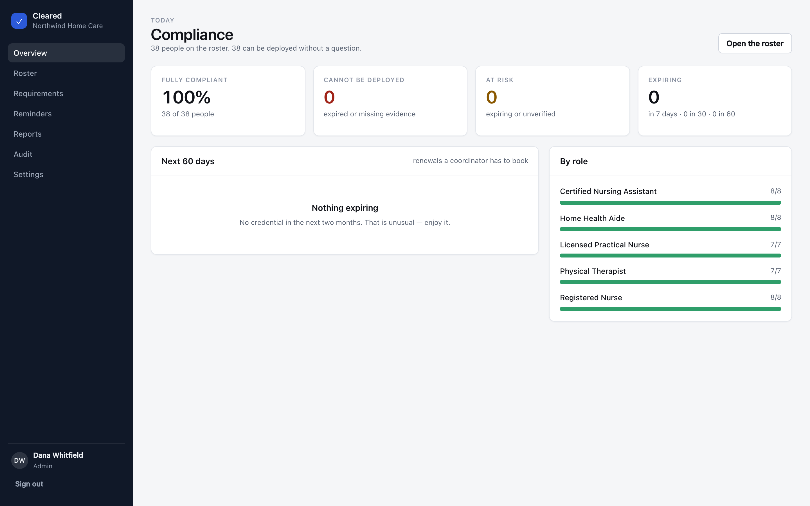
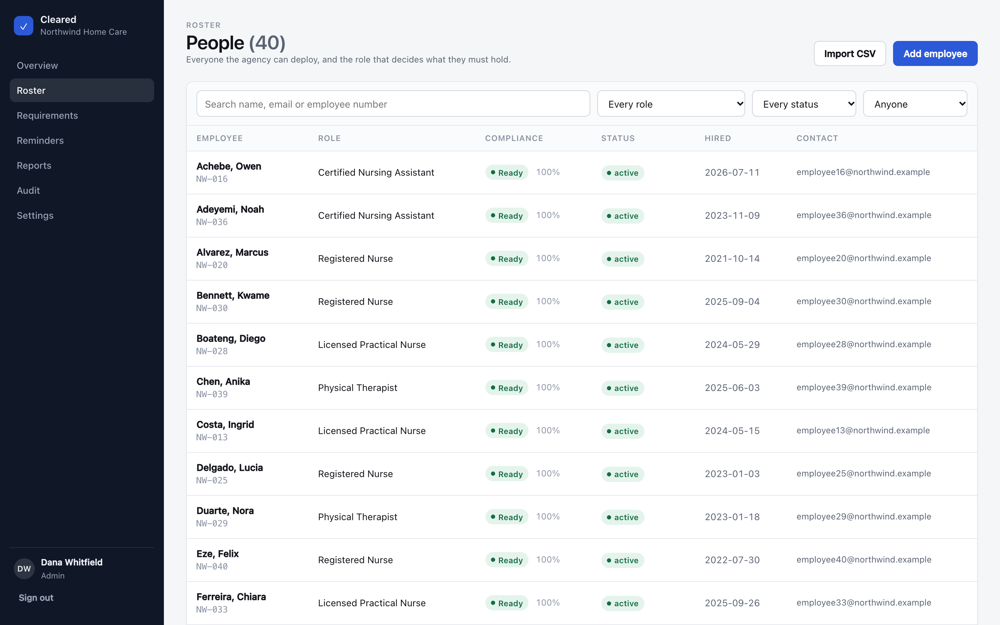
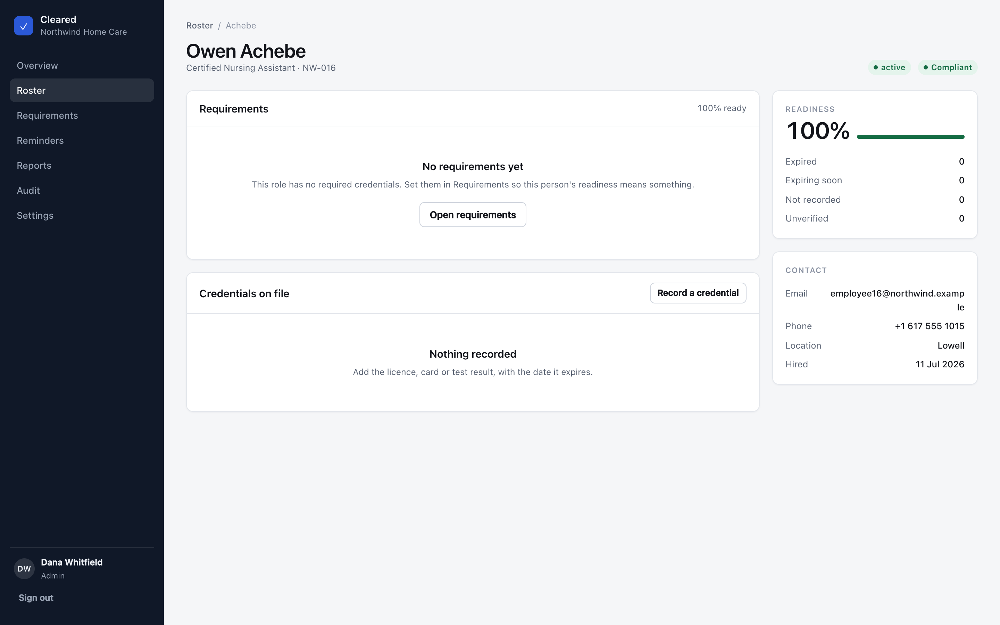

# Cleared

**Credential compliance for home care and medical staffing agencies.**

[](https://github.com/andela-Taiwo/cleared/actions/workflows/ci.yml)



A home care agency cannot send a caregiver to a client without a current state licence, a CPR
card, a negative TB test and a cleared background check. Most agencies track those four things
in a spreadsheet, a paper binder and a coordinator's memory. When someone lapses, the agency
finds out at the worst possible moment: a client complaint, a state survey, or a shift nobody
can staff.

Cleared keeps the roster, the requirements and the expiry dates in one place, answers **who
cannot be deployed today**, and chases renewals before they lapse.

## What it does

- **Roster.** People, roles, locations, status. Import the spreadsheet the agency already keeps.
- **Credential catalogue.** The kinds of evidence an agency recognises, with validity periods.
- **Requirements matrix.** Which credentials each job role must hold. Change it and the whole
  roster re-scores.
- **Compliance.** Every person gets a state — compliant, at risk, blocked — derived from dates
  and requirements, never stored ([why](docs/adr/0003-computed-compliance.md)).
- **Renewal reminders.** Rules at 60/30/14/7/1 days, an idempotent outbox, and a record of what
  was sent ([how](docs/adr/0004-reminder-outbox.md)).
- **Reports.** A compliance report a coordinator can print or hand to a payer, as a page or CSV.
- **Audit.** Who changed what, append-only, written in the same transaction as the change.

| Roster | One person |
|---|---|
|  |  |

## How it works

```
browser ── /v1 ──▶ FastAPI (routes → services → domain)
                        │
                        ├─▶ PostgreSQL, one schema, row-level security per agency
                        └─▶ mail transport (log by default)
```

Two ideas do most of the work:

**Tenant isolation is a database policy, not a `where` clause.** Every tenant-owned table has
row-level security, forced for the table owner too. The API connects as a role that cannot
bypass it. A missing filter leaks nothing. ([ADR 0002](docs/adr/0002-row-level-security.md))

**Compliance is computed, not stored.** State is a pure function of expiry dates, verification
and the requirement matrix — with "today" computed in the agency's timezone, not the server's.
([ADR 0003](docs/adr/0003-computed-compliance.md), [ADR 0005](docs/adr/0005-time-and-timezones.md))

| state | meaning | deployable |
|---|---|---|
| `expired` | the date on the document has passed | no |
| `missing` | the role requires it and nothing is recorded | no |
| `unverified` | recorded, but nobody checked the document | no |
| `expiring` | good, but inside the 60-day horizon | yes — act now |
| `valid` | good, and not urgent | yes |

## Getting started

Requires Python 3.12, Node 22+, Docker, and `uv`.

```bash
git clone https://github.com/andela-Taiwo/cleared.git
cd cleared

cp .env.example .env
docker compose -f infra/docker-compose.yml up -d --wait

uv sync --locked
uv run alembic upgrade head
uv run python -m cleared.seed

make dev      # API on :8000
make web      # web app on :5173
```

Open <http://localhost:5173> and sign in:

| email | role | password |
|---|---|---|
| `admin@northwind.example` | admin | `demo1234!` |
| `coordinator@northwind.example` | coordinator | `demo1234!` |
| `viewer@northwind.example` | viewer | `demo1234!` |

The seed creates Northwind Home Care: 40 people, 9 credential types, a requirement matrix per
role, a mix of valid, expiring, expired, unverified and missing credentials, and 40 days of
reminder history.

## Checks

```bash
make check     # the same commands CI runs: ruff, pyright, pytest, biome, tsc, vitest
```

- **Domain rules** (expiry, compliance, reminder scheduling, timezones) are tested without a
  database.
- **Endpoints** are tested against a real PostgreSQL database. The harness refuses to run
  against anything whose name does not end in `_test`.
- **Isolation** has its own suite: a table without a policy, or a query that forgets its tenant,
  fails the build.

## Layout

```
src/cleared/
  api/          routes, dependencies, problem+json errors
  services/     transactions and orchestration
  domain/       pure rules: compliance, reminders, csv, timezones, models
  db/           session, tenant context, declarative base
  jobs/         the reminder scheduler
  security/     passwords, session tokens
web/            Vite + React + TypeScript client
docs/adr/       decisions and their trade-offs
migrations/     Alembic
```

## Status

Working end to end, deployed to nobody. The honest list of what is not here yet:

- Email delivery is a log transport; the outbox and its interface are real.
- Document upload is modelled but not wired to the credential form.
- No MFA, no SSO, no rate limiting on login.
- One agency per deployment is not enforced; RLS makes multi-agency safe, but signup is manual.

## Licence

MIT — see [LICENSE](LICENSE).
